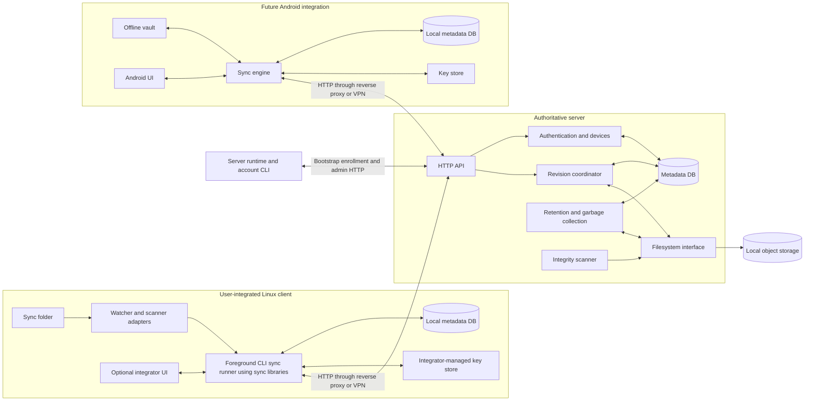
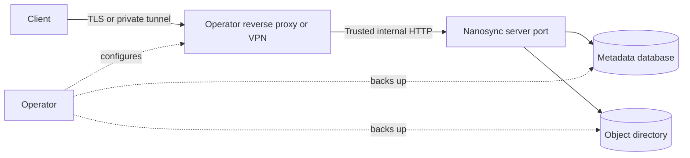

# System Architecture

## Context

Nanosync uses a central authoritative server. Clients own plaintext processing, encryption, decryption, filesystem integration, and conflict materialization. The server authenticates devices, stores immutable encrypted objects, and serializes changes to the current vault head.



## Architectural principles

The version 1 server, Linux adapters, and CLI use Bun and TypeScript. Portable shared code is restricted to Web Crypto and WHATWG interfaces rather than Bun APIs. Native Android UI, scheduling, private journals and shared-folder adapters host the portable engine in a restricted bundled WebView computation worker; see [mobile architecture](mobile.md). The foreground CLI runner is not a separately packaged service, and no desktop UI or startup integration is shipped.

### Immutable data, mutable pointers

Chunks, file objects, manifests, and revisions are immutable. The principal mutable synchronization value is the vault head. This limits partial-write failure modes and makes retries idempotent.

### Client-authoritative cryptography

Clients generate and retain the vault keys. The server stores opaque encrypted payloads and does not decrypt file contents or manifests.

### Server-authoritative ordering

The server assigns an accepted order to published revisions and advances the head atomically. Clients can prepare work offline, but must reconcile with the current head before publication.

### Explicit platform adapters

The shared sync engine must not directly depend on Linux watchers, Android storage APIs, or a particular secure-key facility. Each client platform supplies adapters for:

- Filesystem observation and scanning.
- Local file access.
- Secure credential storage.
- Background scheduling.
- User notifications.

### Replaceable object storage

The first implementation uses local disk, but the server core depends on a narrow `Filesystem` interface. Atomic revision coordination remains in the metadata database and must not depend on filesystem rename semantics.

## Server components

### HTTP API

Exposes authentication, device management, object transfer, revision publication, history, and health endpoints. Requests that mutate state require a unique idempotency key.

### Authentication and device registry

Stores the account password verifier, device approval state, unique device credentials, revocation state, and authentication audit records.

### Revision coordinator

- Reads the current vault head.
- Validates proposed revision structure.
- Verifies that referenced objects exist.
- Advances the head through compare-and-swap.
- Rejects stale proposals without discarding uploaded immutable objects.

### Metadata database

The database contains operational metadata, not plaintext vault contents:

- Account and device records.
- Current vault head.
- Revision index and parent relationships.
- Object existence and integrity metadata.
- Upload sessions and idempotency records.
- Retention and garbage-collection state.

Version 1 uses SQLite through `bun:sqlite` with WAL mode, foreign keys enabled, a 5-second busy timeout, and `synchronous=FULL`. Every write group uses an explicit `BEGIN IMMEDIATE` transaction. A crash may lose unfinished work but must not expose a head without its revision/idempotency metadata. The supported online snapshot and object-store consistency procedure remains to be completed before operational release.

Legacy schema migration 2 adds constrained singleton account, initial-device, recovery-wrap, and bootstrap lifecycle records. Migration 5 preserves these existing vault identities and ciphertext paths while allowing multiple named vault states, independent accepted sequences and recovery wraps; new vault objects are stored under vault-specific paths. Password-only owner initialization can precede any vault, and enrolled device credentials are server-wide. Account identity and recovery-wrap bytes are immutable; a bounded legacy password verifier remains readable, while production replacement writes require a fresh current-baseline tuple and atomically advance its update timestamp. The legacy bootstrap protocol still validates its singleton relationships and fails closed on partial or corrupt state; its completion rechecks catalog state transactionally and publishes genesis/head/lifecycle as one write transaction. Object storage remains outside SQLite, so durable object verification precedes that transaction and failed completion remains retryable.

The metadata database path must name an owner-only (`0600`), singly linked regular file in an owner-only (`0700`) directory owned by the server process; symbolic-link resolution and pre-existing unsafe permissions are rejected rather than repaired. New files are created `0600`, and SQLite WAL/shared-memory sidecars are verified as owner-only. Application migrations are contiguous and checksummed, and each schema change, ledger row, and `user_version` advance commits in one immediate transaction. Version 1 permits a revision to be assembled before acceptance; database triggers require its manifest reference before assigning an accepted sequence and require the head sequence to name that accepted revision. The later revision coordinator must additionally authorize the sole zero-parent genesis case and require one parent for ordinary or two for merge revisions. Device/account foreign keys are intentionally deferred until those registries are introduced; their canonical identifiers are still constrained in this schema.

### Object storage

Suggested interface:

```text
Filesystem {
    put_if_absent(key, stream, expected_checksum)
    open(key, range?)
    stat(key)
    exists_batch(keys)
    delete(key)
    list(prefix, cursor)
}
```

`put_if_absent` must either expose one complete verified object or leave no visible object. Implementations must tolerate repeated writes of the same immutable object.

### Retention and garbage collection

Retention chooses protected revisions. Garbage collection traces from those revisions, marks unreachable immutable objects, waits through a grace period, and deletes only objects that remain unreachable.

### Integrity scanner

The scanner re-reads stored objects and verifies their ciphertext checksums. It reports corruption but cannot validate decrypted plaintext.

## Client components

### Sync engine

A reusable library provides primitives for:

- Chunking, encryption, and object identification.
- Chunk-boundary transfer retry and resumable remote operations.
- Interfaces for local operation journaling (implemented by the separate `client-local` adapter).
- Manifest construction.
- Three-way tree merging.
- Conflict creation.
- Revision publication.
- History inspection and restore planning; an integrator orchestrates publication and filesystem application.

The foreground CLI `sync` command supplies scheduling, single-owner access and recovery sequencing for Linux. Other platforms can integrate the same libraries; starting continuous sync automatically is the user's responsibility.

### Local metadata database

Each device tracks:

- Device and vault identity.
- Last accepted and last applied revisions.
- Stable file IDs and local paths.
- Content fingerprints and relevant metadata.
- Downloaded or remote-only state.
- Pending operations and transfers.
- Watcher-event suppression records.
- Conflicts and user resolution state.

### Durable operation journal

Local mutations are journaled before network publication. After a crash, the client can determine whether an operation needs to be scanned again, uploaded, published, or applied locally.

The Bun-specific `@nanosync/client-local` adapter is the first concrete local journal. It lives outside portable `sync-core` and implements its `ChunkJournal` interface. Each directory connection uses a distinct private journal under `~/.nanosync/replicas`, pinned to one vault/device pair; even two connections sharing a credential never share pending proposals or a lock. SQLite records independent monotonic observed/accepted/applied heads, stable entry identities and hydration state, pending operations/transfers/conflicts, watcher suppression, and one immutable encrypted publication proposal. Database writes use immediate transactions, WAL and `synchronous=FULL`; checksummed ordered migrations, schema/integrity checks and identity checks fail closed on reopen. The cache is bounded private plaintext chunk files rather than a large SQLite blob table. The foreground CLI runner serializes each connection and authenticates cached plaintext with the vault master key on read. No local IPC is shipped.

## Deployment boundary



The server should bind to loopback by default. Binding to a non-loopback interface requires an explicit setting and a startup warning that Nanosync does not provide transport encryption.

## Failure boundaries

- A chunk upload is safe to retry.
- A manifest upload is safe to retry.
- Revision publication is atomic and idempotent.
- A client must not apply a partially downloaded file over a valid local file.
- A server crash cannot expose a revision whose referenced objects were not durable.
- Garbage collection must prefer leaking storage over deleting possibly referenced data.
# Maintenance boundary

Migration 4 adds durable offline GC candidate marks; migrations 1–3 and their checksums are unchanged. Retention selection is a UTC dry run, not revision deletion: with no client merge-base ACK, all accepted/prepared revision ancestry and all their object references remain protected. Only verified unreferenced cataloged uploads can pass offline GC, after creation and candidate grace and repeat transactional reachability checks. The object store has no cross-process lease, so physical deletion is deliberately absent from HTTP and background jobs; operators must stop writers and hold exclusive access to metadata and objects. Integrity scans hash entire ciphertext frames with bounded memory; they do not decrypt vault contents.
