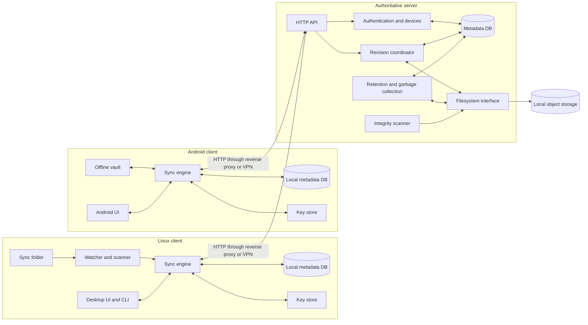
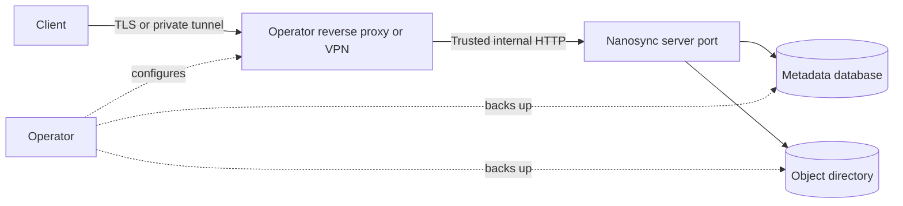

# System Architecture

## Context

Nanosync uses a central authoritative server. Clients own plaintext processing, encryption, decryption, filesystem integration, and conflict materialization. The server authenticates devices, stores immutable encrypted objects, and serializes changes to the current vault head.



## Architectural principles

The version 1 server and Linux CLI use Bun and TypeScript. Portable shared code is restricted to Web Crypto and WHATWG interfaces rather than Bun APIs; Android integration is later platform-adapter work.

### Immutable data, mutable pointers

Chunks, file objects, manifests, and revisions are immutable. The principal mutable synchronization value is the vault head. This limits partial-write failure modes and makes retries idempotent.

### Client-authoritative cryptography

Clients generate and retain the vault keys. The server stores opaque encrypted payloads and does not decrypt file contents or manifests.

### Server-authoritative ordering

The server assigns an accepted order to published revisions and advances the head atomically. Clients can prepare work offline, but must reconcile with the current head before publication.

### Explicit platform adapters

The shared sync engine must not directly depend on Linux watchers, Android storage APIs, or a particular secure-key facility. Each client platform supplies adapters for:

- Filesystem observation and scanning.
- Local file access.
- Secure credential storage.
- Background scheduling.
- User notifications.

### Replaceable object storage

The first implementation uses local disk, but the server core depends on a narrow `Filesystem` interface. Atomic revision coordination remains in the metadata database and must not depend on filesystem rename semantics.

## Server components

### HTTP API

Exposes authentication, device management, object transfer, revision publication, history, and health endpoints. Requests that mutate state require a unique idempotency key.

### Authentication and device registry

Stores the account password verifier, device approval state, unique device credentials, revocation state, and authentication audit records.

### Revision coordinator

- Reads the current vault head.
- Validates proposed revision structure.
- Verifies that referenced objects exist.
- Advances the head through compare-and-swap.
- Rejects stale proposals without discarding uploaded immutable objects.

### Metadata database

The database contains operational metadata, not plaintext vault contents:

- Account and device records.
- Current vault head.
- Revision index and parent relationships.
- Object existence and integrity metadata.
- Upload sessions and idempotency records.
- Retention and garbage-collection state.

Version 1 uses SQLite through `bun:sqlite` with WAL mode, foreign keys enabled, a 5-second busy timeout, and `synchronous=FULL`. Every write group uses an explicit `BEGIN IMMEDIATE` transaction. A crash may lose unfinished work but must not expose a head without its revision/idempotency metadata. The supported online snapshot and object-store consistency procedure remains to be completed before operational release.

### Object storage

Suggested interface:

```text
Filesystem {
    put_if_absent(key, stream, expected_checksum)
    open(key, range?)
    stat(key)
    exists_batch(keys)
    delete(key)
    list(prefix, cursor)
}
```

`put_if_absent` must either expose one complete verified object or leave no visible object. Implementations must tolerate repeated writes of the same immutable object.

### Retention and garbage collection

Retention chooses protected revisions. Garbage collection traces from those revisions, marks unreachable immutable objects, waits through a grace period, and deletes only objects that remain unreachable.

### Integrity scanner

The scanner re-reads stored objects and verifies their ciphertext checksums. It reports corruption but cannot validate decrypted plaintext.

## Client components

### Sync engine

A reusable core responsible for:

- Chunking, encryption, and object identification.
- Transfer scheduling and resumption.
- Local operation journaling.
- Manifest construction.
- Three-way tree merging.
- Conflict creation.
- Revision publication.
- History and restore operations.

### Local metadata database

Each device tracks:

- Device and vault identity.
- Last accepted and last applied revisions.
- Stable file IDs and local paths.
- Content fingerprints and relevant metadata.
- Downloaded or remote-only state.
- Pending operations and transfers.
- Watcher-event suppression records.
- Conflicts and user resolution state.

### Durable operation journal

Local mutations are journaled before network publication. After a crash, the client can determine whether an operation needs to be scanned again, uploaded, published, or applied locally.

## Deployment boundary



The server should bind to loopback by default. Binding to a non-loopback interface requires an explicit setting and a startup warning that Nanosync does not provide transport encryption.

## Failure boundaries

- A chunk upload is safe to retry.
- A manifest upload is safe to retry.
- Revision publication is atomic and idempotent.
- A client must not apply a partially downloaded file over a valid local file.
- A server crash cannot expose a revision whose referenced objects were not durable.
- Garbage collection must prefer leaking storage over deleting possibly referenced data.
