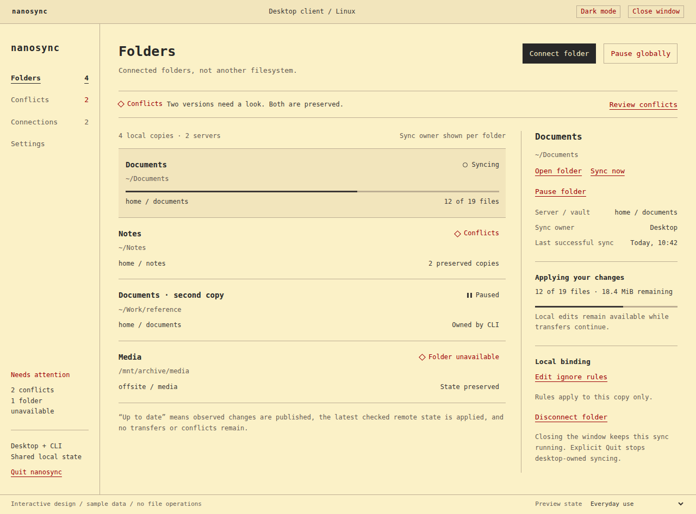
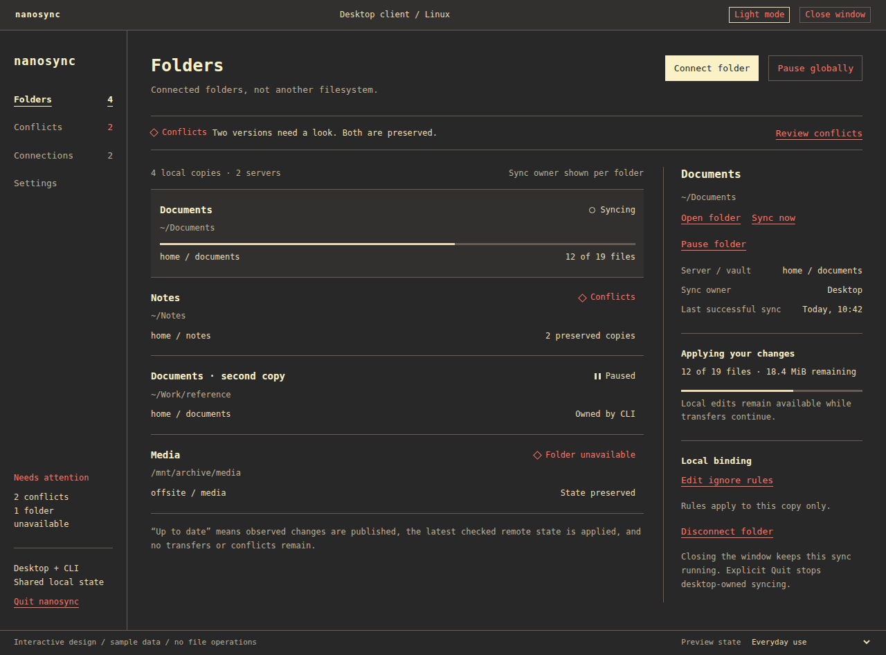
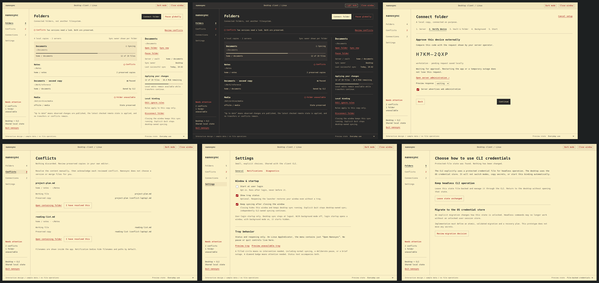

# nanosync desktop — Field Guide design

## Open the prototype

Open [`prototype/index.html`](prototype/index.html) locally after downloading/extracting the bundle. GitHub displays HTML source rather than running it.

This is a standalone, offline HTML interaction prototype, **not** an Electrobun application or a working sync client. It makes no real filesystem, credential-store, sync, enrollment or IPC calls. Sample data is fictional. A diagnostics export deliberately downloads a labeled synthetic JSON report.

Requirements authority: [nanosync issue #18](https://github.com/FireSquid6/nanosync/issues/18). The issue was retrieved from the GitHub API during design. Existing client operations were cross-checked against `packages/cli/README.md` in the nanosync repository. The checkout was not modified.

## Design direction

Carry the approved website's Field Guide into an operating interface: a stable text navigation rail, a ruled list of local bindings, and a selected-folder inspector. Connected folders are the main object; servers are a secondary setup concern. Monospace text, warm Gruvbox grounds, underlined links, square controls and one-pixel rules replace card grids and decorative dashboard chrome.

Use the header theme control to compare light/dark. Use the bottom **Preview state** selector to explore empty, locked, file-backed credential migration, up-to-date, offline and revoked-access examples. Those selectors are prototype tools, not proposed production controls.

## Screens and flows

- **Folders:** multiple servers and multiple local copies of one vault, status/progress, last successful sync, owner, global pause, individual pause, opening, sync-once request, missing-root recovery and disconnect confirmation.
- **Connect folder:** server/account input, device verification, enrollment alternate states, external approval, vault/recovery-key/local path inputs, nonempty-root acknowledgment, lifecycle choices, explicit start or finish-without-sync.
- **Conflicts:** persistent working/preserved copies, manual-resolution explanation and acknowledgment preview, without a merge editor.
- **Connections:** shared state explanation, connection details, safe-removal decision, pending enrollment and explicit file-backed credential migration.
- **Settings:** startup/window/tray choices, individually controllable notification categories, privacy defaults and an explicit diagnostics export.
- **Lifecycle previews:** closing vs. Quit, independently CLI-owned sync, tray-disabled/unavailable behavior and Linux's Open Nanosync-only tray fallback.

## Interpretation boundaries

The visual treatment is a proposal, not approval of every interaction detail. The following need implementation design and actual Linux validation:

- Native Electrobun window lifecycle, tray, OS folder picker and keyring unlock.
- Secure shared-state IPC, single-owner handoff, lock behavior, restart recovery and durable pause/enrollment state.
- Atomic credential migration without duplicate secrets or surprise headless breakage.
- Real parsing/validation of `.nanosyncignore`, including already-tracked-entry safeguards.
- Conflict acknowledgment semantics shared with the CLI.
- Redaction and deduplication in actual notifications/diagnostics.

Prototype form state is in-memory and sample-driven. It does not model server discovery, passwords, recovery-key validity, key-store APIs, or all possible engine errors. Enrollment response and ignore-validation selectors simulate responses, not local implementations of security checks. Sample conflicts and connection records stay visible after preview acknowledgments/removal. Prototype actions should not be mistaken for completed backend operations.

No server setup, vault creation/deletion, in-app device approval, remote file browser, eviction, history/restore, merge editor or updater is proposed. Linux is the initial target; this design makes no validated cross-platform support claim.

## Files

- `DESIGN.md`: desktop layout/component rules.
- `REQUIREMENTS.md`: requirements-to-screen matrix and backend validation boundary.
- `VERIFICATION.md`: test results and the independent review/fix record.
- `prototype/`: `index.html`, `verify.cjs`, `verification.json`, and `screenshots/`.
- `handoff.zip`: portable copy of this handoff, excluding the archive itself.

Screenshots are real Chromium renders. Browser interaction checks are repeatable via `prototype/verify.cjs`. Install Playwright in a tools workspace and set `PLAYWRIGHT_MODULE` to its module path; optionally set `CHROMIUM_PATH` to an existing Chromium executable. Run native acceptance tests separately when the real client exists.

## Review images

