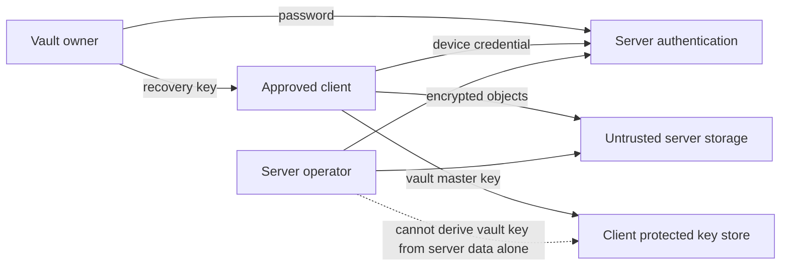
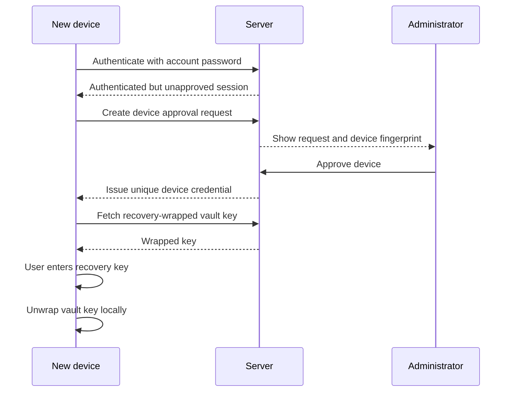

# Security and Trust Model

## Goals

- Prevent the server from reading file contents or encrypted manifests.
- Authenticate each device independently.
- Require explicit approval before a new device can access vault objects.
- Recover vault access with a user-held recovery key.
- Detect modification or corruption of encrypted objects.
- Limit a revoked device's future access to the server.

## Non-goals

- Hiding all traffic patterns, object sizes, or revision timing.
- Recovering data without an authorized device or recovery key.
- Erasing plaintext or keys already copied to a lost device.
- Protecting plaintext from a compromised client device.
- Providing transport security without a reverse proxy, VPN, or trusted network.
- Protecting data when the server and an unlocked client are compromised together.

## Trust boundaries



The server is trusted for availability and ordering but not for confidentiality of vault data. A malicious server can deny service, replay old data, omit revisions, or lie about availability. Clients should detect integrity violations and obvious rollback where local state permits, but complete anti-rollback protection requires an external trust anchor and is not a version 1 goal.

## Key hierarchy

At vault creation, the client generates a random vault master key and derives domain-separated subkeys for:

- File chunk encryption.
- Manifest encryption.
- Vault-scoped chunk identifiers.
- Other future object classes.

Conceptually:

```text
master_key
├── chunk_encryption_key
├── manifest_encryption_key
├── chunk_identifier_key
└── future domain-separated keys
```

Version 1 uses HKDF-SHA-256 with the 16-byte UUID binary vault ID as salt, the 32-byte vault master key as input key material, and these exact ASCII `info` labels: `nanosync/v1/chunk-encryption-root`, `nanosync/v1/manifest-key`, `nanosync/v1/revision-private-key`, `nanosync/v1/revision-authentication-key`, and `nanosync/v1/chunk-identifier-key`. Per-chunk AES keys use the chunk-encryption root as input, keyed chunk ID bytes as salt, and `nanosync/v1/chunk-key` as `info`. Labels are never NUL-terminated.

## Recovery key

- Generate a 256-bit random recovery secret during vault setup.
- Present it once with a strong instruction to store it offline.
- Derive a key-encryption key from the recovery secret.
- Store a recovery-wrapped vault master key on the server.
- Do not store the recovery secret or a directly reusable equivalent on the server.
- Validate recovery locally by authenticated unwrapping.

The displayed form is lowercase unpadded RFC 4648 base32: 52 secret symbols followed by 7 checksum symbols, grouped from the left in groups of five (the final group may be shorter). Checksum version 1 is the first four bytes of `SHA-256(ASCII("nanosync/v1/recovery-checksum") || 0x00 || secret)`, base32-encoded canonically. Decoders reject noncanonical padding/bits before checking it. HKDF-SHA-256 derives the wrapping key directly from decoded high-entropy bytes using vault-ID salt and `nanosync/v1/recovery-wrap-key`; this is not password stretching. The vault master key is wrapped with AES-256-GCM, a random 96-bit nonce. Its AAD is JCS of `{"algorithm":"A256GCM","label":"nanosync/v1/aad/recovery-wrap","vaultId":"<canonical vault UUID>","version":1}`. The encrypted value is exactly 32 ciphertext bytes followed by the 16-byte GCM tag.

A lost recovery key combined with the loss of every authorized device results in permanent data loss. The product must communicate this without implying that an administrator can reset encryption.

## Authentication and enrollment

Password authentication and vault decryption are separate.



Password verifier version 1 is Argon2id with 64 MiB memory (`m=65536` KiB), 3 iterations, parallelism 1, a random 16-byte salt, and 32-byte output. Accepted records are capped at 1 GiB memory, 10 iterations, parallelism 8, salt 16–64 bytes, and output 32–64 bytes before allocation. Successful login upgrades weaker/older accepted records to the current baseline. Rate limiting is still required. Password verification never derives or wraps the vault key.

Bootstrap accepts passwords of 1–1,024 UTF-8 bytes and applies that byte limit before Argon2 allocation. The database stores the algorithm/version/costs, salt, and output as separate constrained fields; it never stores the password. Principal identity and account creation time are immutable. A later successful login may replace the complete verifier tuple in one transaction with a fresh current-baseline verifier and a strictly newer verifier-update timestamp; the production repository rejects weaker replacement writes. Readers retain the broader bounded algorithm/parameter/length acceptance needed to verify a legacy weaker record before upgrading it, but those bounds do not permit downgrade writes or weaken baseline account creation.

The bootstrap authorization dependency is operator-supplied secret/authentication logic outside the database. If it is absent, throws, or does not explicitly accept, every bootstrap mutation fails closed. Loopback source addresses and forwarding headers never authorize bootstrap. Authorization material, passwords, verifier bytes, salts, recovery wraps, recovery secrets, and vault keys are excluded from responses and public errors.

After approval, each device receives a unique opaque 256-bit random bearer credential. The server stores only `HMAC-SHA-256(server_credential_pepper, credential)` and compares digests in constant time. Credentials do not expire in v1; re-enrollment rotates them. Revocation invalidates subsequent requests and active sessions. The pepper is stored outside the database with least-privilege permissions and must be included in protected, access-controlled backups; loss invalidates all credentials.

## Device approval

Approval should show enough information to identify the request:

- Device-generated name.
- Platform and client version.
- Request time.
- Short fingerprint derived from the device public key or credential request.

Approval authorizes future server requests but does not reveal vault keys. The user must still enter the recovery key on the new device.

## Revocation

Revocation:

- Marks the device credential unusable.
- Rejects future requests from that device.
- Ends or invalidates active sessions where practical.
- Records an audit event.

Revocation does not:

- Delete plaintext already stored on the device.
- Remove a vault key already copied to it.
- Prevent decryption of encrypted objects already downloaded.
- Rotate the vault key or re-encrypt history.

The UI must describe this as access revocation, not data erasure.

## Object encryption

Objects use authenticated encryption. Each encrypted object includes enough versioned, authenticated metadata for clients to determine:

- Object type.
- Encryption format version.
- Plaintext length or bounded size information needed for allocation.
- Nonce or derivation inputs.
- Vault identity binding.

Vault-scoped chunk IDs are HMAC-SHA-256 over plaintext under the chunk-identifier key. Derive an independent AES-256-GCM key per chunk as specified above, then use the fixed all-zero 96-bit nonce only with that per-chunk key. JCS AAD contains label `nanosync/v1/aad/chunk`, object format, crypto format, vault ID, object type `chunk`, chunk ID, and plaintext length. This deterministic construction leaks equality within a vault and **requires independent cryptographic review before production**.

Manifests and revision-private payloads use their domain key, AES-256-GCM, and a fresh random 96-bit nonce. Their JCS AAD uses respectively `nanosync/v1/aad/manifest` or `nanosync/v1/aad/revision-private` plus object format, crypto format, vault ID, object type, object ID, and plaintext length. SHA-256 checksums cover ciphertext envelope bytes.

The revision-authentication key computes HMAC-SHA-256 over exact ASCII label `nanosync/v1/reference-set-mac`, one zero byte, and JCS of the public revision envelope excluding the MAC. This binds parents, identities, encrypted-manifest ID, and the complete server-visible reference entries without a self-checksum cycle.

## Metadata exposure

The encrypted manifest hides names, paths, file metadata, and plaintext digests from ordinary server inspection. The server can still observe:

- Account and device records.
- Revision graph shape and timing.
- Object identifiers and equality within the vault.
- Ciphertext sizes and aggregate storage.
- Exact object types and per-revision reference membership/reuse exposed by the canonical visible reference set.
- Access times and network addresses unless hidden by the operator's network.

This is traffic-analysis resistance neither in design nor in scope.

## Transport security

The Nanosync server exposes HTTP and does not terminate TLS in version 1.

Recommended safeguards:

- Bind to loopback by default.
- Require an explicit option for non-loopback binding.
- Warn prominently when exposed without an acknowledged trusted network.
- Document reverse-proxy forwarding and maximum body-size requirements.
- Support a configured trusted-proxy list before accepting forwarded client addresses.
- Never treat arbitrary forwarding headers as authenticated identity.
- Mark all authentication cookies secure at the external TLS boundary, or prefer header-based device credentials for clients.

## Integrity

- The server validates checksums over stored ciphertext.
- Authenticated encryption lets clients detect ciphertext modification.
- Clients verify complete reconstructed file digests.
- Revisions authenticate their manifest references and parents inside encrypted or signed client-controlled data.
- Clients should retain their last accepted head and warn on unexplained rollback.

## Local plaintext

Linux and Android clients retain plaintext data locally. Security depends on:

- Device login controls.
- Full-disk or file-based device encryption.
- Correct application sandboxing on Android.
- Secure deletion limitations of modern filesystems and flash media.

Exports to other Android applications or user-created copies may escape the application sandbox and Nanosync lifecycle controls.

## Required security review items

Before implementation is considered production-ready, review:

- Key derivation and recovery wrapping.
- Deterministic vault-scoped chunk encryption.
- Device credential format and rotation.
- Password hashing parameters.
- Replay and rollback behavior.
- Manifest authenticity and parent binding.
- Resource-exhaustion limits on uploads, manifests, and decompression if introduced.
- Filesystem path traversal and symlink handling.
- Reverse-proxy trust configuration.
- Secret storage on Linux and Android.
