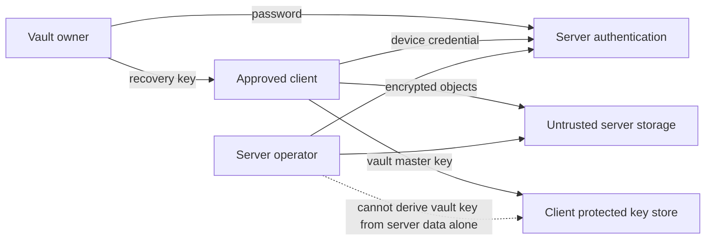
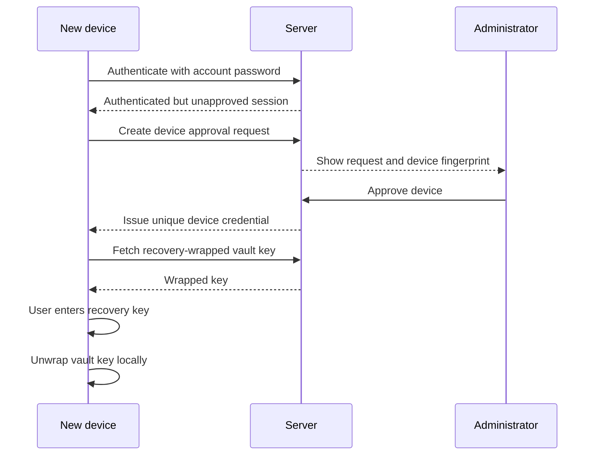

# Security and Trust Model

## Goals

- Prevent the server from reading file contents or encrypted manifests.
- Authenticate each device independently.
- Require explicit approval before a new device can access vault objects.
- Recover vault access with a user-held recovery key.
- Detect modification or corruption of encrypted objects.
- Limit a revoked device's future access to the server.

## Non-goals

- Hiding all traffic patterns, object sizes, or revision timing.
- Recovering data without an authorized device or recovery key.
- Erasing plaintext or keys already copied to a lost device.
- Protecting plaintext from a compromised client device.
- Providing transport security without a reverse proxy, VPN, or trusted network.
- Protecting data when the server and an unlocked client are compromised together.

## Trust boundaries



The server is trusted for availability and ordering but not for confidentiality of vault data. A malicious server can deny service, replay old data, omit revisions, or lie about availability. Clients should detect integrity violations and obvious rollback where local state permits, but complete anti-rollback protection requires an external trust anchor and is not a version 1 goal.

## Key hierarchy

At vault creation, the client generates a random vault master key and derives domain-separated subkeys for:

- File chunk encryption.
- Manifest encryption.
- Vault-scoped chunk identifiers.
- Other future object classes.

Conceptually:

```text
master_key
├── chunk_encryption_key
├── manifest_encryption_key
├── chunk_identifier_key
└── future domain-separated keys
```

Actual derivation must use a standard key-derivation function with explicit context labels and a versioned format.

## Recovery key

- Generate a high-entropy recovery secret during vault setup.
- Present it once with a strong instruction to store it offline.
- Derive a key-encryption key from the recovery secret.
- Store a recovery-wrapped vault master key on the server.
- Do not store the recovery secret or a directly reusable equivalent on the server.
- Validate recovery locally by authenticated unwrapping.

A lost recovery key combined with the loss of every authorized device results in permanent data loss. The product must communicate this without implying that an administrator can reset encryption.

## Authentication and enrollment

Password authentication and vault decryption are separate.



Server-side password storage must use a current memory-hard password hashing construction with per-account salt and versioned parameters. The exact primitive and parameters are recorded in the implementation decision log after security review.

After approval, the device should authenticate with a unique high-entropy credential or signing key rather than repeatedly sending the account password.

## Device approval

Approval should show enough information to identify the request:

- Device-generated name.
- Platform and client version.
- Request time.
- Short fingerprint derived from the device public key or credential request.

Approval authorizes future server requests but does not reveal vault keys. The user must still enter the recovery key on the new device.

## Revocation

Revocation:

- Marks the device credential unusable.
- Rejects future requests from that device.
- Ends or invalidates active sessions where practical.
- Records an audit event.

Revocation does not:

- Delete plaintext already stored on the device.
- Remove a vault key already copied to it.
- Prevent decryption of encrypted objects already downloaded.
- Rotate the vault key or re-encrypt history.

The UI must describe this as access revocation, not data erasure.

## Object encryption

Objects use authenticated encryption. Each encrypted object includes enough versioned, authenticated metadata for clients to determine:

- Object type.
- Encryption format version.
- Plaintext length or bounded size information needed for allocation.
- Nonce or derivation inputs.
- Vault identity binding.

Vault-scoped deduplication requires equal chunks in one vault to map to the same identifier and stored ciphertext. This creates equality leakage within the vault. It must not enable cross-vault comparison if multiple vaults are introduced later.

The concrete deterministic-encryption construction requires dedicated cryptographic review. Do not improvise by reusing a nonce with a shared key. One acceptable design direction is deriving an independent encryption key for each chunk from the vault key and keyed chunk identifier, then using a fixed nonce only under that unique per-chunk key.

## Metadata exposure

The encrypted manifest hides names, paths, file metadata, and plaintext digests from ordinary server inspection. The server can still observe:

- Account and device records.
- Revision graph shape and timing.
- Object identifiers and equality within the vault.
- Ciphertext sizes and aggregate storage.
- Access times and network addresses unless hidden by the operator's network.

This is traffic-analysis resistance neither in design nor in scope.

## Transport security

The Nanosync server exposes HTTP and does not terminate TLS in version 1.

Recommended safeguards:

- Bind to loopback by default.
- Require an explicit option for non-loopback binding.
- Warn prominently when exposed without an acknowledged trusted network.
- Document reverse-proxy forwarding and maximum body-size requirements.
- Support a configured trusted-proxy list before accepting forwarded client addresses.
- Never treat arbitrary forwarding headers as authenticated identity.
- Mark all authentication cookies secure at the external TLS boundary, or prefer header-based device credentials for clients.

## Integrity

- The server validates checksums over stored ciphertext.
- Authenticated encryption lets clients detect ciphertext modification.
- Clients verify complete reconstructed file digests.
- Revisions authenticate their manifest references and parents inside encrypted or signed client-controlled data.
- Clients should retain their last accepted head and warn on unexplained rollback.

## Local plaintext

Linux and Android clients retain plaintext data locally. Security depends on:

- Device login controls.
- Full-disk or file-based device encryption.
- Correct application sandboxing on Android.
- Secure deletion limitations of modern filesystems and flash media.

Exports to other Android applications or user-created copies may escape the application sandbox and Nanosync lifecycle controls.

## Required security review items

Before implementation is considered production-ready, review:

- Key derivation and recovery wrapping.
- Deterministic vault-scoped chunk encryption.
- Device credential format and rotation.
- Password hashing parameters.
- Replay and rollback behavior.
- Manifest authenticity and parent binding.
- Resource-exhaustion limits on uploads, manifests, and decompression if introduced.
- Filesystem path traversal and symlink handling.
- Reverse-proxy trust configuration.
- Secret storage on Linux and Android.
