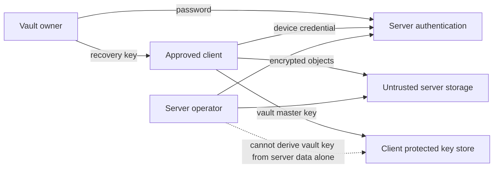
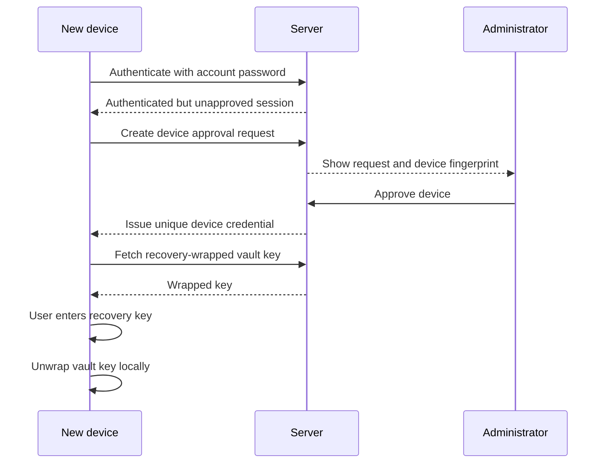

# Security and Trust Model

## Goals

- Keep ordinary persisted server data encrypted (with the explicit transient
  server-local provisioning exception below).
- Authenticate each device independently.
- Require explicit approval before a new device can access vault objects.
- Recover vault access with a user-held recovery key.
- Detect modification or corruption of encrypted objects.
- Limit a revoked device's future access to the server.

## Non-goals

- Hiding all traffic patterns, object sizes, or revision timing.
- Recovering data without an authorized device or recovery key.
- Erasing plaintext or keys already copied to a lost device.
- Protecting plaintext from a compromised client device.
- Providing transport security without a reverse proxy, VPN, or trusted network.
- Protecting data when the server and an unlocked client are compromised together.

## Trust boundaries



The server is trusted for availability and ordering but ordinary persisted server data is not trusted for confidentiality. Server-local provisioning temporarily trusts the operator machine with newly generated keys. Browser provisioning additionally trusts the served code: a compromised origin can exfiltrate passwords, secrets and keys despite TLS and CSP. Use a trusted native client for stronger separation; protection against malicious served JavaScript is not promised. A malicious server can deny service, replay old data, omit revisions, or lie about availability. Clients should detect integrity violations and obvious rollback where local state permits, but complete anti-rollback protection requires an external trust anchor and is not a version 1 goal.

## Key hierarchy

At vault creation, the client generates a random vault master key and derives domain-separated subkeys for:

- File chunk encryption.
- Manifest encryption.
- Vault-scoped chunk identifiers.
- Other future object classes.

Conceptually:

```text
master_key
├── chunk_encryption_key
├── manifest_encryption_key
├── chunk_identifier_key
└── future domain-separated keys
```

Version 1 uses HKDF-SHA-256 with the 16-byte UUID binary vault ID as salt, the 32-byte vault master key as input key material, and these exact ASCII `info` labels: `nanosync/v1/chunk-encryption-root`, `nanosync/v1/manifest-key`, `nanosync/v1/revision-private-key`, `nanosync/v1/revision-authentication-key`, and `nanosync/v1/chunk-identifier-key`. Per-chunk AES keys use the chunk-encryption root as input, keyed chunk ID bytes as salt, and `nanosync/v1/chunk-key` as `info`. Labels are never NUL-terminated.

## Recovery key

- Generate a 256-bit random recovery secret during vault setup.
- Present it once with a strong instruction to store it offline.
- Derive a key-encryption key from the recovery secret.
- Store a recovery-wrapped vault master key on the server.
- Do not store the recovery secret or a directly reusable equivalent on the server.
- Validate recovery locally by authenticated unwrapping.

The displayed form is lowercase unpadded RFC 4648 base32: 52 secret symbols followed by 7 checksum symbols, grouped from the left in groups of five (the final group may be shorter). Checksum version 1 is the first four bytes of `SHA-256(ASCII("nanosync/v1/recovery-checksum") || 0x00 || secret)`, base32-encoded canonically. Decoders reject noncanonical padding/bits before checking it. HKDF-SHA-256 derives the wrapping key directly from decoded high-entropy bytes using vault-ID salt and `nanosync/v1/recovery-wrap-key`; this is not password stretching. The vault master key is wrapped with AES-256-GCM, a random 96-bit nonce. Its AAD is JCS of `{"algorithm":"A256GCM","label":"nanosync/v1/aad/recovery-wrap","vaultId":"<canonical vault UUID>","version":1}`. The encrypted value is exactly 32 ciphertext bytes followed by the 16-byte GCM tag.

The recovery-wrap AAD member names are exactly `algorithm`, `label`, `vaultId`, `version`; the JSON above is already in JCS order. No extra fields, alternate names, or terminators are permitted.

A lost recovery key combined with the loss of every authorized device results in permanent data loss. The product must communicate this without implying that an administrator can reset encryption.

## Authentication and enrollment

Password authentication and vault decryption are separate.



Password verifier version 1 is Argon2id with 64 MiB memory (`m=65536` KiB), 3 iterations, parallelism 1, a random 16-byte salt, and 32-byte output. Accepted records are capped at 1 GiB memory, 10 iterations, parallelism 8, salt 16–64 bytes, and output 32–64 bytes before allocation. Successful login upgrades weaker/older accepted records to the current baseline. Rate limiting is still required. Password verification never derives or wraps the vault key.

Bootstrap accepts passwords of 1–1,024 UTF-8 bytes and applies that byte limit before Argon2 allocation. The database stores the algorithm/version/costs, salt, and output as separate constrained fields; it never stores the password. Principal identity and account creation time are immutable. A later successful login may replace the complete verifier tuple in one transaction with a fresh current-baseline verifier and a strictly newer verifier-update timestamp; the production repository rejects weaker replacement writes. Readers retain the broader bounded algorithm/parameter/length acceptance needed to verify a legacy weaker record before upgrading it, but those bounds do not permit downgrade writes or weaken baseline account creation.

The bootstrap authorization dependency is operator-supplied secret/authentication logic outside the database. If it is absent, throws, or does not explicitly accept, every bootstrap mutation fails closed. Loopback source addresses and forwarding headers never authorize bootstrap. Authorization material, passwords, verifier bytes, salts, recovery wraps, recovery secrets, and vault keys are excluded from responses and public errors.

After approval, each device receives a unique opaque 256-bit random bearer credential. The server stores only `HMAC-SHA-256(server_credential_pepper, credential)` and compares digests in constant time. Credentials do not expire in v1; re-enrollment rotates them. Revocation invalidates subsequent requests and active sessions. The pepper is stored outside the database with least-privilege permissions and must be included in protected, access-controlled backups; loss invalidates all credentials.

The password endpoint creates a random 256-bit token and stores only its pepper-HMAC digest. A token initially authenticates only enrollment creation/status. Enrollment extends its lifetime from 10 minutes to 24 hours. Approval transactionally promotes that digest into the device credential field, so no plaintext credential is persisted or delivered in a second lossy response; the already client-held token becomes the credential. The designated bootstrap device is activated exactly once only when its password session also carries an independently verified operator bootstrap handoff. Password plus knowledge of the initial UUID is insufficient. The handoff uses a separate header, is checked by the injected bootstrap authorizer after sealing, and does not reopen any bootstrap mutation route. Exact retries by the already promoted session do not consume a second handoff. Responses containing a token or recovery wrap use `Cache-Control: no-store`.

Password failures use one persistent account-global bucket because v1 has one account and does not trust remote or forwarding addresses. Five failures in 15 minutes lock login for 15 minutes, including across restart. This permits unauthenticated denial of service; proxy/IP buckets may only be added after explicit proxy trust configuration. At most two Argon2 jobs run concurrently. Public failures do not distinguish wrong passwords, missing account state, verifier corruption, or internal verification errors.

Successful login rechecks both the active lockout and the exact verifier tuple inside the session-creation transaction after asynchronous Argon2 verification. Establishing lockout invalidates unbound password sessions. This prevents a delayed successful verifier job or stale pre-upgrade verifier from committing after concurrent security state changed.

## Device approval

Approval should show enough information to identify the request:

- Device-generated name.
- Platform and client version.
- Request time.
- Short fingerprint derived from the device public key or credential request.

Approval authorizes future server requests but does not reveal vault keys. The user must still enter the recovery key on the new device.

## Revocation

Revocation:

- Marks the device credential unusable.
- Rejects future requests from that device.
- Ends or invalidates active sessions where practical.
- Records an audit event.

Revocation does not:

- Delete plaintext already stored on the device.
- Remove a vault key already copied to it.
- Prevent decryption of encrypted objects already downloaded.
- Rotate the vault key or re-encrypt history.

Device-admin routes reject self-revocation and any revocation that would remove the last active administrator. Explicit owner operations use separate browser/server-local provenance, not a fabricated device; they may revoke even the last device administrator. Revocation clears the server credential digest and enrollment session in one transaction.

The UI must describe this as access revocation, not data erasure.

## Object encryption

Objects use authenticated encryption. Each encrypted object includes enough versioned, authenticated metadata for clients to determine:

- Object type.
- Encryption format version.
- Plaintext length or bounded size information needed for allocation.
- Nonce or derivation inputs.
- Vault identity binding.

Vault-scoped chunk IDs are HMAC-SHA-256 over plaintext under the chunk-identifier key. Derive an independent AES-256-GCM key per chunk as specified above, then use the fixed all-zero 96-bit nonce only with that per-chunk key. JCS AAD contains label `nanosync/v1/aad/chunk`, object format, crypto format, vault ID, object type `chunk`, chunk ID, and plaintext length. This deterministic construction leaks equality within a vault and **requires independent cryptographic review before production**.

Manifests and revision-private payloads use their domain key, AES-256-GCM, and a fresh random 96-bit nonce. Their JCS AAD uses respectively `nanosync/v1/aad/manifest` or `nanosync/v1/aad/revision-private` plus object format, crypto format, vault ID, object type, object ID, and plaintext length. SHA-256 checksums cover ciphertext envelope bytes.

**Normative v1 object AAD JSON:** for every object type, the exact seven member names, JCS ordering, and types are `{"cryptoFormatVersion":1,"label":"nanosync/v1/aad/<objectType>","objectFormatVersion":1,"objectId":"<64 lowercase hex>","objectType":"<objectType>","plaintextLength":<positive safe integer>,"vaultId":"<canonical lowercase UUID>"}`. Substitute `chunk`, `manifest`, or `revision-private` for `<objectType>` in both places; for chunks `objectId` is the keyed plaintext HMAC ID. Bracketed substitutions here describe values, not literal bytes. Use RFC 8785 JCS UTF-8 of the resulting JSON object as the complete AES-GCM AAD, with no NUL or header bytes appended. No other names (including `chunkId`, `objectFormat`, or `cryptoFormat`) or members are permitted.

The revision-authentication key computes HMAC-SHA-256 over exact ASCII label `nanosync/v1/reference-set-mac`, one zero byte, and JCS of the public revision envelope excluding the MAC. This binds parents, identities, encrypted-manifest ID, and the complete server-visible reference entries without a self-checksum cycle.

For this MAC, parse and validate the exact v1 `RevisionEnvelope` in [formats.md](formats.md), remove only `referenceSetMac`, then serialize the remaining object with RFC 8785 JCS as UTF-8. The top-level JCS member order is `createdAt`, `creatingDeviceId`, `encryptedManifestObjectId`, `parents`, `protocolVersion`, `references`, `revisionFormatVersion`, `revisionId`, `vaultId`; each visible reference uses `ciphertextChecksum`, `ciphertextLength`, `objectFormatVersion`, `objectId`, `objectType` in JCS order. Arrays retain their validated ordering. The MAC field itself and any whitespace, stringified JSON, or byte-order mark outside JCS are not part of the MAC input.

## Metadata exposure

The encrypted manifest hides names, paths, file metadata, and plaintext digests from ordinary server inspection. The server can still observe:

- Account and device records.
- Revision graph shape and timing.
- Object identifiers and equality within the vault.
- Ciphertext sizes and aggregate storage.
- Exact object types and per-revision reference membership/reuse exposed by the canonical visible reference set.
- Access times and network addresses unless hidden by the operator's network.

This is traffic-analysis resistance neither in design nor in scope.

## Transport security

The Nanosync server exposes HTTP and does not terminate TLS in version 1.

Recommended safeguards:

- Bind to loopback by default.
- Require an explicit option for non-loopback binding.
- Warn prominently when exposed without an acknowledged trusted network.
- Document reverse-proxy forwarding and maximum body-size requirements.
- Support a configured trusted-proxy list before accepting forwarded client addresses.
- Never treat arbitrary forwarding headers as authenticated identity.
- Mark all authentication cookies secure at the external TLS boundary, or prefer header-based device credentials for clients.

## Integrity

- The server validates checksums over stored ciphertext.
- Authenticated encryption lets clients detect ciphertext modification.
- Clients verify complete reconstructed file digests.
- Revisions authenticate their manifest references and parents inside encrypted or signed client-controlled data.
- Clients should retain their last accepted head and warn on unexplained rollback.

## Local plaintext

Linux and Android clients retain plaintext data locally. Security depends on:

- Device login controls.
- Full-disk or file-based device encryption.
- Correct application sandboxing on Android.
- Secure deletion limitations of modern filesystems and flash media.

Exports to other Android applications or user-created copies may escape the application sandbox and Nanosync lifecycle controls.

## Required security review items

Before implementation is considered production-ready, review:

- Key derivation and recovery wrapping.
- Deterministic vault-scoped chunk encryption.
- Device credential format and rotation.
- Password hashing parameters.
- Replay and rollback behavior.
- Manifest authenticity and parent binding.
- Resource-exhaustion limits on uploads, manifests, and decompression if introduced.
- Filesystem path traversal and symlink handling.
- Reverse-proxy trust configuration.
- Secret storage on Linux and Android.

### Owner provisioning boundary

The owner-administration redesign intentionally permits server-local provisioning to handle plaintext vault keys and new recovery material transiently on the operator machine. It must not persist plaintext master keys or recovery secrets in ordinary server state; an explicitly requested protected recovery-output file is the delivery-only exception. Browser provisioning instead submits only existing-format encrypted frames, a recovery wrap, and a MAC-authenticated genesis envelope. Owner-created genesis uses reserved author UUID `00000000-0000-4000-8000-000000000001` in both manifest and envelope: this is an author label, never an enrolled device or credential. Encryption and MAC formats are unchanged. A malicious server can deliver malicious browser code; browser provisioning does not defend against that threat.

Shared owner operations require an already authenticated owner boundary; their actor object records provenance, not proof of authentication. Browser session authentication, CSRF, transport policy, and deletion confirmations belong to the invoking surface. Verification codes are public comparisons of immutable enrollment identity/fingerprint, never authenticators.

### Opt-in browser administration

`server run --web-ui` enables the separate `/admin/api` owner boundary. Without
that flag all `/admin` assets and endpoints return 404. Browser sessions are
256-bit random, runtime-memory-only capabilities, never enrollment/device
credentials. Their cookies are HttpOnly, SameSite=Strict, Path=/admin, Secure
under HTTPS, with no persistence lifetime. Logout removes the session; restart
invalidates all sessions. Exact 30-minute idle and 12-hour absolute limits use
the injected server clock. At most 1,000 concurrent sessions are retained.

Every mutation, **including login**, requires an exact allowed `Origin` and a
nonempty `X-Nanosync-CSRF` header; authenticated mutations must additionally
match the random token returned by session login/inspection. The login header
is a custom-header/preflight defense, not a previously issued secret. No CORS
permission is granted. Foreign/null origins are rejected. Browser routes reject
Authorization headers rather than falling back to device or enrollment tokens.
Cookies never authorize device, recovery, revision or object routes.

Browser password verification (login and deletion combined) reserves at most
five attempts per rolling minute per runtime before asynchronous Argon2 work,
including successful attempts. Failed passwords also use the persistent shared
account lockout. Success mints no device token. Deletion requires the current
exact vault name and password, then uses shared owner tombstoning/cleanup.

Nonloopback browser HTTP is forbidden even with `--acknowledge-exposure`.
For TLS termination configure `--external-origin https://sync.example` and
`--trusted-proxy <exact-IP>`. The programmatic `trustedProxyAddresses` option
accepts multiple exact IPs. Only Bun's observed socket peer establishes proxy
trust; forwarding headers are ignored entirely. The configured external origin
is authoritative for trusted peers (proxies must restrict public host/origin
routing accordingly). Without proxy trust, the actual request URL must be HTTPS
or loopback HTTP on a loopback listener and must match any configured origin.
Do not expose a trusted proxy's backend listener to untrusted users on that
same peer address. Capability links use only the validated configured origin,
never Host/Forwarded headers; without it the enabled capability omits its URL.


### Secret delivery versus ordinary persistence

Hidden prompts or protected secret files/environment supply passwords and recovery
input; never put literal secrets in argv. Ordinary logs, JSON results, audit events,
metadata and encrypted creation receipts contain no plaintext keys/recovery secrets.
An explicitly requested protected recovery-output file is an intentional delivery
artifact, not a server key store: deliver/back it up offline, then remove the
operator copy. Secret files and their private parents require owner-only permissions;
symlinks/hardlinks and unsafe files fail visibly. Browser storage contains only
an encrypted request receipt; refresh requires secret proof before publication.
Acknowledgement/durable file delivery happens before owner mutation. Clearing byte
arrays and UI fields reduces exposure but is not a guarantee of erasure from a
JavaScript runtime, swap, crash dump or compromised host.

Successful audit events identify timestamp, action, target and browser/server-local
origin, not filenames or secrets. Device revocation only prevents future access;
owner deletion only destroys server data. Neither invalidates retained client keys
or wipes local work. Deleted bindings stop with `VAULT_DELETED` rather than apply
an empty manifest. Backups remain separate copies and must have their own access
and retention controls.
