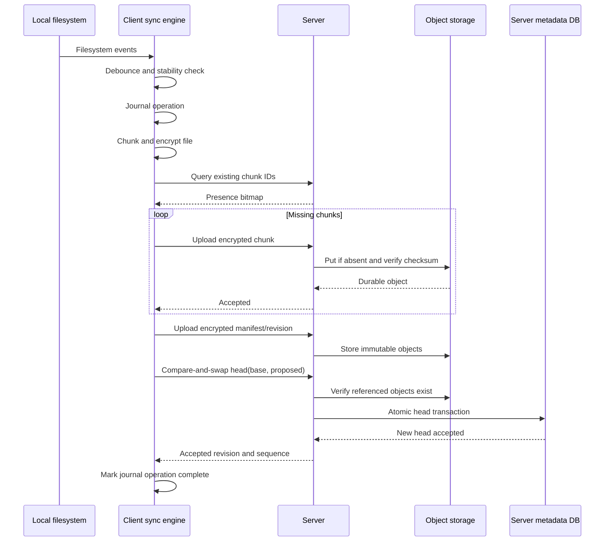
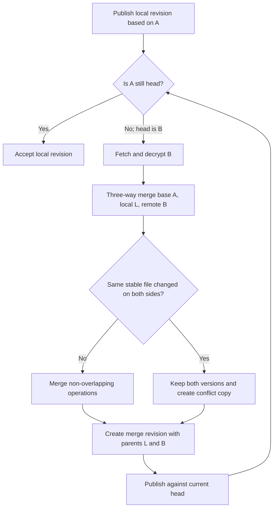
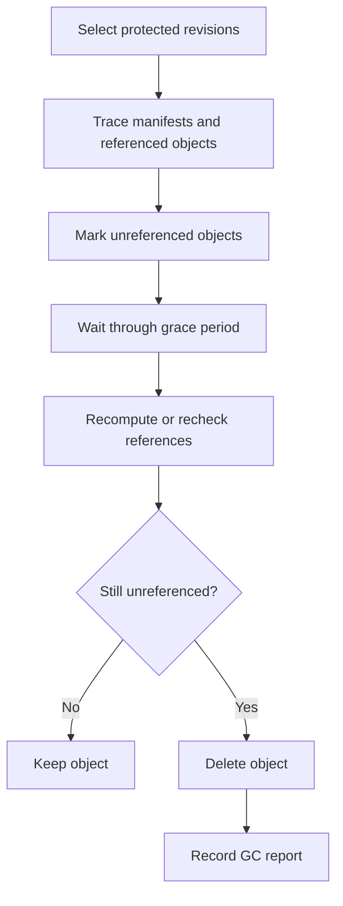

# Data Model and Synchronization Protocol

## Object model

### Vault-scoped chunk

A chunk is an immutable encrypted segment of a file. Version 1 uses 4 MiB fixed chunks, with only the final chunk smaller; the parameter is recorded per file/format and processing is streaming.

```text
Chunk {
    chunk_id
    ciphertext
    ciphertext_checksum
    ciphertext_length
    format_version
}
```

The final chunk may be shorter than the configured fixed chunk size. `chunk_id` is derived with a vault-scoped secret so the server does not receive an ordinary public plaintext hash.

### File object

```text
FileObject {
    stable_file_id
    ordered_chunk_ids
    plaintext_size
    plaintext_digest
    executable_hint
    format_version
}
```

The file object is a record inside the encrypted manifest; no separate file-object reference exists. The plaintext digest is client-visible only and is used for local validation and change detection. The exact closed, canonical v1 JSON schema and bounds (including 50 GB files, 4 MiB manifest plaintext, and 20,000 references) are frozen in [formats.md](formats.md#encrypted-manifest-plaintext-v1).

### Tree entry

```text
TreeEntry {
    stable_entry_id
    parent_directory_id
    name
    kind
    ordered_chunk_ids_and_lengths?  // file only
    deleted_kind?                   // tombstone only
    supported_metadata
}
```

Paths are derived from parent relationships and names. Stable IDs allow renames and moves to preserve history. The unique root has an empty name and null parent; every other entry has a directory parent. Live files include size, whole-file SHA-256, and executable hint; tombstones retain ID/former kind but no content. Tombstone locations may be archived under a surviving directory when a new live file takes the old path or its parent is deleted; never reuse the tombstone ID for the new file. Archival names must satisfy normal path/name and sibling uniqueness limits. Conflict copies have new IDs and optional source entry/revision lineage. Unsupported special filesystem entries are rejected rather than serialized.

### Revision

```text
Revision {
    protocol_version
    revision_id
    parent_revision_ids
    encrypted_manifest_object_id
    creating_device_id
    client_timestamp
    server_sequence?
    format_version
    visible_object_references
    reference_set_mac
}
```

The sorted, unique visible reference array gives object ID, type, SHA-256 ciphertext checksum, ciphertext length, and object format for every object needed by the revision. It contains exactly one manifest reference and one chunk reference per distinct live chunk ID, with no missing or extraneous IDs. The server verifies this list before publication and uses it for GC. A domain-separated revision MAC binds the exact canonical envelope/reference set for client verification without requiring an encrypted object to contain its own checksum. Readers verify this MAC **before** manifest decryption, then authenticate the manifest's vault/revision/parent/device binding and exact chunk-reference set. This exposes revision graph, object membership, type, size, equality, and reuse to the server while names and contents remain encrypted; see [formats.md](formats.md).

## Normal change flow



## Save detection

A filesystem watcher event is only a hint. The Linux client:

1. Collects events during a configurable debounce interval.
2. Recognizes common temporary-file-and-rename save patterns where practical.
3. Waits until relevant file metadata remains stable for the stability interval.
4. Reads the file and computes its chunk set.
5. Before publication, verifies that the file did not change during reading.
6. Retries the scan if the file changed.

Several paths that settle in the same debounce window may be published in one revision. This preserves a coherent directory state and avoids creating a revision for every low-level write.

## Transfer resumption

Resumption occurs at chunk boundaries:

1. The client deterministically computes vault-scoped chunk IDs.
2. It asks the server which IDs already exist.
3. It uploads only missing chunks.
4. A failed request retries the current chunk.
5. A restarted client reconstructs pending work from its journal and repeats the presence query.
6. The revision is published only after every referenced chunk is durable.

The server may retain unreferenced chunks from abandoned transfers until a garbage-collection grace period expires.

## Head coordination

The server exposes an atomic operation equivalent to:

```text
advanceHead(expectedRevisionId, proposedRevision, idempotencyKey)
```

Possible results:

- `accepted`: the proposed revision is now head.
- `alreadyAccepted`: the same idempotent request previously succeeded.
- `staleHead`: another revision is current; the client must merge.
- `missingObjects`: one or more referenced immutable objects are unavailable.
- `invalidRevision`: structure, authorization, size, or format validation failed.

These camelCase names are the exact JSON wire spellings. General failures use the versioned error envelope and stable code vocabulary in [formats.md](formats.md).

The protected endpoints are `GET /v1/head`, `GET /v1/revisions/{revisionId}`, and `POST /v1/head/advance`. Revision retrieval includes the immutable normalized public envelope and a separate accepted sequence (or null for a prepared stale proposal), leaving MAC-covered fields unchanged. The normal advance endpoint never creates genesis. It retains valid stale proposals so a later two-parent merge can name both the current head and stale proposal; it does not perform the client-side merge.

## Concurrent edit reconciliation



Directory operations are merged by stable identity rather than only by path. A client must bound automatic retries and surface persistent contention instead of looping indefinitely.

`mergeManifests(base, local, remote, { revisionId, creatingDeviceId, localCreatedAt, remoteCreatedAt })` in `sync-core` is the portable plaintext merge primitive. Inputs must be verified/decrypted by the caller first; it checks complete v1 trees, common vault and root identity, distinct revision IDs, and both branches naming the supplied base as a parent. It produces a new manifest with the supplied revision ID/device, two sorted parents (prepared stale local revision and fetched current remote head), and a separate explicit conflict report. New conflict-copy IDs are deterministic SHA-256-derived UUIDs scoped to the vault/base/branches/origin and checked against all input IDs. Existing chunk lists, lengths, digests, and executable flags are copied unchanged and the completed manifest is parsed and size-checked before return. The caller must construct/upload the new encrypted manifest and exact chunk reference set, MAC the revision envelope, publish with compare-and-swap against the fetched remote head, and verify the response. This primitive does not authenticate input ciphertext or perform publication.

For repeated stale-head responses, fetch and authenticate the newer head, find/verify a valid common ancestor, merge again using the new head and a new prepared local revision, and bound publication attempts (recommended maximum three); surface persistent contention rather than silently choosing a version. Do not reuse a previous merge result as if it were based on a new head. An unsafe tree, missing identity without a deleted ancestor, invalid ancestry or namespace, exceeded name/manifest limit, or unresolved collision is a visible failure requiring user intervention.

## Conflict rules

### Modify versus modify

- Preserve one version at the original path according to a deterministic rule.
- Write the other as a conflict copy with a new stable file ID.
- Include source device and time in the conflict name.
- Retain ancestry so the UI can show both origins.

### Delete versus modify

- Keep the tombstone for the original file ID.
- Create the modified content as a conflict copy with a new ID.
- Do not silently restore the deleted original path.
- If a directory is deleted while the other branch moves/renames it or changes its descendants, retain its original tombstone and materialize a new conflict directory at the surviving destination. Retain that branch's entire subtree, including unchanged children, new children and prior tombstones, reparenting its direct children to the new directory without changing descendant IDs. Resolve any resulting name collision with the normal conflict-name policy; fail visibly if no valid reconstruction exists.

### Rename versus modify

If identity is unambiguous, apply the content modification to the renamed identity.

### Rename versus rename

If both devices choose different destinations, preserve one deterministic destination and materialize or report the other as a naming conflict.

### Name collision

If different stable IDs resolve to the same path, retain both identities but materialize one with a conflict name. Never overwrite one file merely because a platform cannot represent both names.

## Deletion and eviction

Deletion and eviction are distinct operations:

- **Deletion:** Adds a tombstone to the next synchronized revision.
- **Eviction:** Removes plaintext from one Linux device while leaving the vault entry unchanged.

Eviction sequence:

1. Confirm that the current file object is present in an accepted server revision.
2. Record remote-only state and watcher suppression transactionally.
3. Delete the local plaintext.
4. Consume the expected watcher event without creating a tombstone.
5. Retain the remote-only entry in local client state so an integrator-provided UI can display it; the shipped CLI does not display it.

An unexpected external deletion is treated as a synchronized deletion after the normal debounce period.

## Download and local application

- Download objects into temporary client-controlled paths.
- Authenticate and decrypt every chunk before use.
- Reconstruct the complete file and verify its plaintext digest.
- Apply the completed file atomically where the platform supports it.
- Do not replace a valid local file with a partial or unauthenticated download.
- Suppress watcher events caused by applying a known remote revision.

## History retention

Default protected revisions are selected as follows:

- All revisions within 3 days.
- One representative revision per day through 30 days.
- One representative revision per month through one year.
- The current head regardless of age.

Day and month buckets use UTC and retain the newest server-accepted revision in each bucket. Retention is deterministic and visible in a dry-run report. Current state, unresolved conflicts, active transfers, and merge bases still needed by clients are always protected.

## Garbage collection



Active upload sessions, recent unreferenced objects, and revisions used as merge bases must be protected. Deletion waits a 24-hour grace period and then rechecks reachability and protections. If reachability is uncertain, retain the object.

## Protocol evolution

Every stored object and API request carries a format or protocol version. New readers may support older objects, but a client must not publish a format the server has not advertised. Capability negotiation should be explicit rather than inferred from server version strings.

## Owner browser API (opt-in)

`webAdministration: { enabled: boolean, url?: string }` is required in
`GET /v1/capabilities`. A URL, when present, is a configured trustworthy
HTTPS (or loopback HTTP) `/admin` link, without credentials/query/fragment.
It is absent when disabled or no external origin was configured.

Browser routes live exclusively under `/admin/api`; they require memory-only
owner sessions, not bearer credentials. See [security.md](security.md) for
transport, origin, cookie and CSRF rules. JSON results include
`protocolVersion: 1`; errors use the existing protocol error envelope.

| Method/path | JSON input / result |
| --- | --- |
| POST session | `{password}` → `{authenticated:true,csrfToken}` + session cookie |
| GET session | `{authenticated:true,csrfToken}` |
| DELETE session | logout; expire cookie |
| GET devices | `{devices,enrollments}`; pending entries include comparison code and timestamps |
| POST devices/:uuid/approve or deny or revoke | `{}`; exact device identity required |
| GET vaults | `{vaults}` |
| POST vaults | strict encrypted owner creation request (see progress contracts); replay-safe |
| POST vaults/:uuid/rename | `{name}` |
| POST vaults/:uuid/delete | `{confirmName,password}`; exact current name, password reauthentication; immediately tombstones |
| GET activity?limit=100 | `{activity}`; integer limit 1–100, newest first, no secret/details/file names |

All paths above are relative to `/admin/api`. Mutation bodies use
`application/json` and reject unknown/duplicate fields. GET/DELETE session
require no body. Login needs a nonempty custom `X-Nanosync-CSRF` header;
subsequent mutations use the returned random `csrfToken` in that header.
Activity is the only endpoint accepting query parameters. Responses are
noncacheable. Invalid sessions return 401, origin/CSRF/transport violations 403,
invalid input 400, conflicts 409, rate limits 429 with Retry-After. Owner-deleted
vault creation IDs return 410 VAULT_DELETED. Deletion acknowledges durable
unavailability, not completed physical reclamation; the runtime cleanup worker
performs that asynchronously.

Approved-device `GET /v1/vaults` and `/v1/recovery-wrap` remain available.
Device-authorized vault create/rename routes are removed (404). Existing
`/v1/admin` device-admin operations retain their separate bearer authentication
and device self/last-administrator safeguards.
