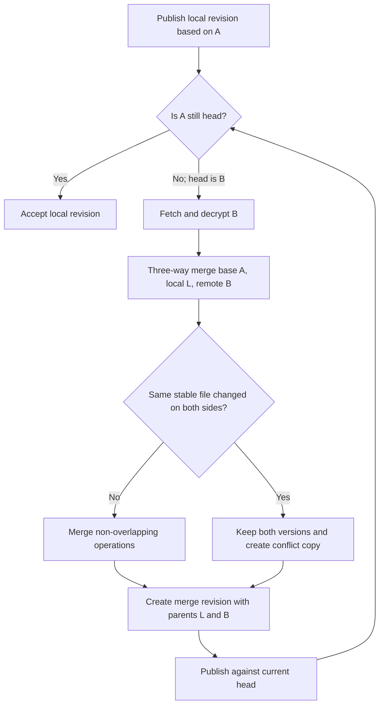
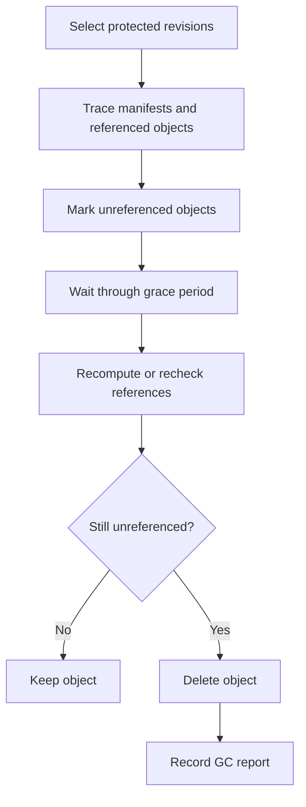

# Data Model and Synchronization Protocol

## Object model

### Vault-scoped chunk

A chunk is an immutable encrypted segment of a file.

```text
Chunk {
    chunk_id
    ciphertext
    ciphertext_checksum
    ciphertext_length
    format_version
}
```

The final chunk may be shorter than the configured fixed chunk size. `chunk_id` is derived with a vault-scoped secret so the server does not receive an ordinary public plaintext hash.

### File object

```text
FileObject {
    stable_file_id
    ordered_chunk_ids
    plaintext_size
    plaintext_digest
    executable_hint
    format_version
}
```

The file object is included in or referenced by the encrypted manifest. The plaintext digest is client-visible only and is used for local validation and change detection.

### Tree entry

```text
TreeEntry {
    stable_entry_id
    parent_directory_id
    name
    kind
    file_object_id?
    tombstone?
    supported_metadata
}
```

Paths are derived from parent relationships and names. Stable IDs allow renames and moves to preserve history.

### Revision

```text
Revision {
    revision_id
    parent_revision_ids
    encrypted_manifest_object_id
    creating_device_id
    client_timestamp
    server_sequence?
    format_version
}
```

The revision envelope exposes only the coordination metadata required by the server. The tree manifest remains encrypted.

## Normal change flow

```mermaid
sequenceDiagram
    participant FS as Local filesystem
    participant C as Client sync engine
    participant S as Server
    participant O as Object storage
    participant D as Server metadata DB

    FS->>C: Filesystem events
    C->>C: Debounce and stability check
    C->>C: Journal operation
    C->>C: Chunk and encrypt file
    C->>S: Query existing chunk IDs
    S-->>C: Presence bitmap
    loop Missing chunks
        C->>S: Upload encrypted chunk
        S->>O: Put if absent and verify checksum
        O-->>S: Durable object
        S-->>C: Accepted
    end
    C->>S: Upload encrypted manifest/revision
    S->>O: Store immutable objects
    C->>S: Compare-and-swap head(base, proposed)
    S->>O: Verify referenced objects exist
    S->>D: Atomic head transaction
    D-->>S: New head accepted
    S-->>C: Accepted revision and sequence
    C->>C: Mark journal operation complete
```



## Save detection

A filesystem watcher event is only a hint. The Linux client:

1. Collects events during a configurable debounce interval.
2. Recognizes common temporary-file-and-rename save patterns where practical.
3. Waits until relevant file metadata remains stable for the stability interval.
4. Reads the file and computes its chunk set.
5. Before publication, verifies that the file did not change during reading.
6. Retries the scan if the file changed.

Several paths that settle in the same debounce window may be published in one revision. This preserves a coherent directory state and avoids creating a revision for every low-level write.

## Transfer resumption

Resumption occurs at chunk boundaries:

1. The client deterministically computes vault-scoped chunk IDs.
2. It asks the server which IDs already exist.
3. It uploads only missing chunks.
4. A failed request retries the current chunk.
5. A restarted client reconstructs pending work from its journal and repeats the presence query.
6. The revision is published only after every referenced chunk is durable.

The server may retain unreferenced chunks from abandoned transfers until a garbage-collection grace period expires.

## Head coordination

The server exposes an atomic operation equivalent to:

```text
advance_head(expected_revision, proposed_revision, idempotency_key)
```

Possible results:

- `accepted`: the proposed revision is now head.
- `already_accepted`: the same idempotent request previously succeeded.
- `stale_head`: another revision is current; the client must merge.
- `missing_objects`: one or more referenced immutable objects are unavailable.
- `invalid_revision`: structure, authorization, size, or format validation failed.

## Concurrent edit reconciliation



Directory operations are merged by stable identity rather than only by path. A client must bound automatic retries and surface persistent contention instead of looping indefinitely.

## Conflict rules

### Modify versus modify

- Preserve one version at the original path according to a deterministic rule.
- Write the other as a conflict copy with a new stable file ID.
- Include source device and time in the conflict name.
- Retain ancestry so the UI can show both origins.

### Delete versus modify

- Keep the tombstone for the original file ID.
- Create the modified content as a conflict copy with a new ID.
- Do not silently restore the deleted original path.

### Rename versus modify

If identity is unambiguous, apply the content modification to the renamed identity.

### Rename versus rename

If both devices choose different destinations, preserve one deterministic destination and materialize or report the other as a naming conflict.

### Name collision

If different stable IDs resolve to the same path, retain both identities but materialize one with a conflict name. Never overwrite one file merely because a platform cannot represent both names.

## Deletion and eviction

Deletion and eviction are distinct operations:

- **Deletion:** Adds a tombstone to the next synchronized revision.
- **Eviction:** Removes plaintext from one Linux device while leaving the vault entry unchanged.

Eviction sequence:

1. Confirm that the current file object is present in an accepted server revision.
2. Record remote-only state and watcher suppression transactionally.
3. Delete the local plaintext.
4. Consume the expected watcher event without creating a tombstone.
5. Show the entry in the app and CLI as remote-only.

An unexpected external deletion is treated as a synchronized deletion after the normal debounce period.

## Download and local application

- Download objects into temporary client-controlled paths.
- Authenticate and decrypt every chunk before use.
- Reconstruct the complete file and verify its plaintext digest.
- Apply the completed file atomically where the platform supports it.
- Do not replace a valid local file with a partial or unauthenticated download.
- Suppress watcher events caused by applying a known remote revision.

## History retention

Default protected revisions are selected as follows:

- All revisions within 3 days.
- One representative revision per day through 30 days.
- One representative revision per month through one year.
- The current head regardless of age.

The exact boundary timezone and the representative chosen within a day or month remain implementation decisions. Retention should be deterministic and visible in a dry-run report.

## Garbage collection



Active upload sessions, recent unreferenced objects, and revisions used as merge bases must be protected. If reachability is uncertain, retain the object.

## Protocol evolution

Every stored object and API request carries a format or protocol version. New readers may support older objects, but a client must not publish a format the server has not advertised. Capability negotiation should be explicit rather than inferred from server version strings.
